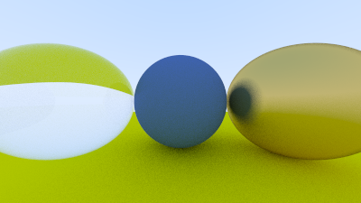

# One program, six languages

I asked an AI (Claude Code, Sonnet 5.5) to write the same ray tracer in six languages from the same prompt, then timed the programs.
Every program drew exactly the same picture:

<p align="center"></p>

Video: link added when it is published.

## Results

| Language | Time to draw the picture | Compared with C++ |
|---|---:|---:|
| C++ | 1.68 s | 1.0x |
| Rust | 1.85 s | 1.1x |
| Go | 2.19 s | 1.3x |
| Java | 2.48 s | 1.5x |
| JavaScript | 4.87 s | 2.9x |
| Python | 126.54 s | 75.3x |

Median of 5 runs on an Apple M1 MacBook Pro with 8 GB. The picture is 400x225 pixels with 200 samples per pixel. C++, Rust and Go finished close together.
This is one program on one machine, not a ruling on which language is faster.

## How it worked

- The same prompt and the same four files for every language. Only the language name and the build command change.
- A new Claude Code session for each language. The prompt never asks for speed.
- A picture counts only if it matches `reference.ppm` (no colour value off by more than 1). All six matched exactly.
- Each program was built and run 5 times in fresh processes, one at a time. Compiling is not timed.

## Notes

- These are six different programs written by an AI, so differences in the code count too, not only the language.
- The spec forbids fused multiply-add, but Go's compiler uses it by default (6 instructions in the timed program, see `checks/`). The picture still matched exactly.
- Go and Python were each generated twice. The timings use the second program.
- `spec/rng.md` still has a leftover line saying "samples 0 through 19". The prompt and spec say 200, and all six programs used 200.

## Folders

`prompt/` the prompts, `spec/` the files given to the AI, `programs/` the six programs, `recordings/` the session recordings, `bench/` the timing tool,
`results/` the raw timings, `checks/` the fused multiply-add check. The book behind the program: [Ray Tracing in One Weekend](https://raytracing.github.io/books/RayTracingInOneWeekend.html)
by Peter Shirley, Trevor David Black and Steve Hollasch.

## Run it yourself

```
python3 bench/run.py python=programs/python javascript=programs/javascript go=programs/go java=programs/java cpp=programs/cpp rust=programs/rust
python3 bench/compare.py path/to/out.ppm     # check one picture
```

No licence has been chosen yet.
